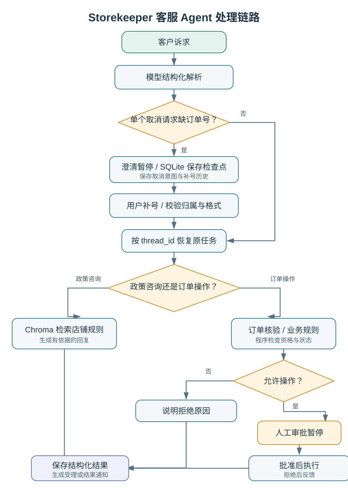

# Storekeeper Agent：有审批约束的电商客服助手

基于 [Rahat-Kabir/store-keeper](https://github.com/Rahat-Kabir/store-keeper) 的开源二开与工程实践，使用 **Python、LangChain、LangGraph、FastAPI、SQLite、Chroma、React**。

## 业务问题

售后请求既包含政策咨询，也包含取消订单等会改变业务状态的操作。信息不完整时，直接转人工会中断处理；异步接口收到请求也不等于取消或退款已完成。

本项目保留“模型理解诉求、代码核验规则、人工审批操作”的分工，重点完善单个取消请求的缺参追问、任务恢复与结果反馈。真实 DeepSeek 已接入；本地预览中的 Shopify 订单与写入是模拟数据，不处理真实交易。

## 本次二开与复用范围

- **原项目已有**：结构化意图解析、订单查询、业务规则、人工审批、LangGraph 工作流与 SQLite 检查点、政策标题切块与 Chroma 检索、基础 API 与 React 控制台。
- **本次扩展**：单个取消请求缺订单号时暂停追问；补号后保留原意图与任务，接续原有核验审批流程；支持 API、CLI、网页入口，校验参数、工单与暂停点归属。
- **状态与回复**：增加 `submitted` 受理结果，标注未验证结算；对含受理任务的工单按结构化结果生成回执，避免模型提前确认取消或退款完成。
- **模型与评测**：增加官方 DeepSeek 适配、真实模型与测试订单预览；固定开发/测试样本，保留逐条结果、用量和检索证据。

代码与实验借助 Codex 协助完成，项目定位为开源二开学习实践；不将上游能力描述为原创，也没有生产客户、收益或真实商店部署数据。

## 处理链路



检查点复用 LangGraph 提供的持久化机制。业务状态记忆只覆盖工单内的结构化追问，不是通用长期记忆。进程内锁不提供多进程互斥或外部业务“恰好执行一次”的保证。


## 增强 RAG（二开，2026-11-04）

针对中文查询英文规则的漏召回问题，新增 LangGraph 检索子图：查询改写、
BM25/向量双路召回、RRF 融合、LLM 证据筛选与原文引用核验，资料不足时
转人工。原10条中文合成回归题 Recall@3 从60%升至100%；保留网络失败、
补测及引用校验修复的全部过程，新增英文题仍有漏召回，不能包装为生产效果。

- [设计、运行和参考资料](docs/advanced-rag.md)
- [实测结果与失败分析](docs/advanced-rag-results.md)
- [原始评测证据](evidence/advanced_rag)

运行 `start_rag_preview.cmd` 打开真实模型＋模拟订单的增强预览（8767端口），
或先运行 `uv run python scripts/index_policies.py`，再运行
`uv run python -m storekeeper.live_preview --rag enhanced --port 8767`。
会消耗模型API额度。默认仍为 baseline，可显式切换 enhanced；没有新增外部
Embedding或重排服务。最终140项本地测试通过。

## 模型选择外部工具

新增真正的只读工具调用：模型通过 `bind_tools` 选择店铺规则检索和外部
Frankfurter 汇率换算工具，Python 校验并执行，再通过 ToolMessage 回传。
LangGraph 循环限制最多3次工具执行，订单操作仍走原审批流程。
运行 `run_readonly_agent.cmd` 或 `uv run python scripts/run_tool_agent.py`。
详情见 [工具设计与真实调用](docs/read-only-tool-agent.md)，
[真实轨迹](evidence/advanced_rag/read_only_tool_agent.json)。

## 快速运行

需要 Python 3.11+、[uv](https://docs.astral.sh/uv/) 与 Node.js/npm。

```sh
uv sync
cd frontend
npm ci
npm run build
cd ..
uv run python -m storekeeper.demo --port 8765
```

打开 http://127.0.0.1:8765/ 。此模式使用固定解析器与测试订单，无需模型密钥，适合验证交互流程。

体验顺序：提交“帮我取消订单” → 等待补充 → 输入 `1036` → 出现审批 → 批准或拒绝。另建工单补充 `1037`，测试已发货订单被规则拒绝。两个编号都是模拟订单。

### 真实模型 + 模拟订单

将 `.env.example` 复制为本机 `.env`，填写自己的 `DEEPSEEK_API_KEY` 与服务商支持的 `DEEPSEEK_MODEL`。密钥不要提交到仓库。默认示例记录了本轮使用的 `deepseek-flash`；服务商可用模型可能变化，需按自己账号确认。

```sh
uv run python -m storekeeper.live_preview --port 8766
```

打开 http://127.0.0.1:8766/ 。此模式真实调用 DeepSeek，可能产生调用费用，但订单仍为模拟数据。

政策问答使用检索前，另运行 `uv run python scripts/index_policies.py` 建立应用索引；首次使用原有向量模型需要下载模型文件。订单核验规则不依赖检索结果。

## 验证与学习入口

```sh
uv run python -m unittest discover -s tests -v
uv run python scripts/evaluate_retrieval.py
# 下一条会再次调用真实模型并计费
uv run python scripts/evaluate_reliability.py
```

最近一次本地测试为 131 项通过。真实 DeepSeek 在预先固定的 40 条合成测试中意图/订单号严格匹配 40/40；4 条模拟订单 API 流程通过。此结果不是线上准确率或真实业务执行成功率。

检索基线使用 5 份英文政策、18 个标题段落和原 Top3 检索配置：40 条英文合成问题 Recall@3 为 44/44 = 100%，Precision@3 为 44/120 = 36.67%；10 条中文对照分别为 60% 与 20%。6 条无答案问题仍返回片段；没有因此声称回答一定幻觉，也没有验证通用回答准确率。本轮仅建立基线，未优化检索。使用自写段落 ID 计分，未调用 Ragas 库。

- [二开范围与设计取舍](docs/FORK_CHANGES.md)
- [测试方法与评测边界](docs/testing.md)
- [本轮原始评测证据](evidence/)
- 核心代码：`graph/clarification.py`（追问）、`graph/build.py`（编排）、`api/`（交互约束）、`submission_receipts.py`（可信受理通知）、`policy_docs.py`（原检索实现）。上述路径位于 `src/storekeeper/`。

## 当前边界

- 追问只扩展“单个取消请求缺订单号”，不支持任意多轮任务重规划。
- 尚未验证真实 Shopify 取消、退款到账或异步完成轮询。
- 没有新实现 MCP、多 Agent、微调、Ragas 或跨进程业务幂等。
- 一些开发记录沿用上游的早期实现说明；涉及本地二开的验证，以本页及 `docs/FORK_CHANGES.md` 为准。

## 来源与许可

上游作者 Rahat Kabir，基准版本 `9c1d5644effac7aed10079d23fc2a9f3f2982b1a`。本地基于官方 codeload 快照开展二开，上传仓库不包含完整上游提交历史。

保留上游 [MIT License](LICENSE) 及版权声明。`docs/UPSTREAM_README.md` 与 July 日期记录是来源留档，其上游实测/部署描述不等于本人的实现或验证经历。
