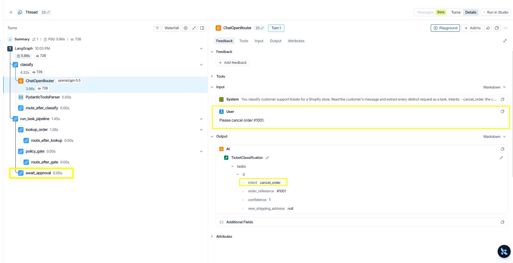
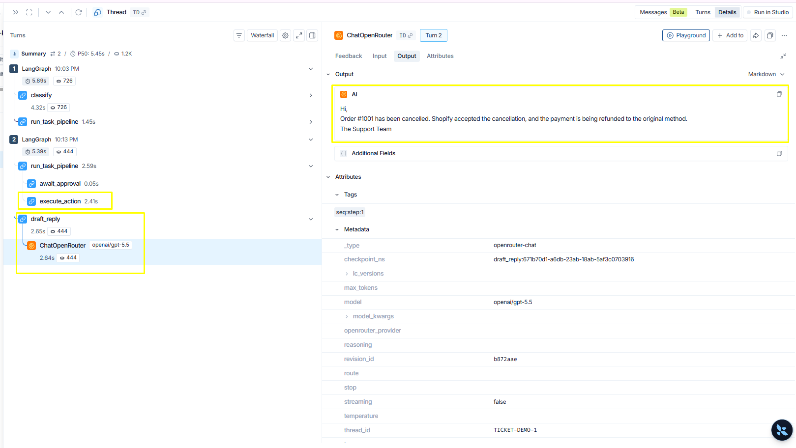
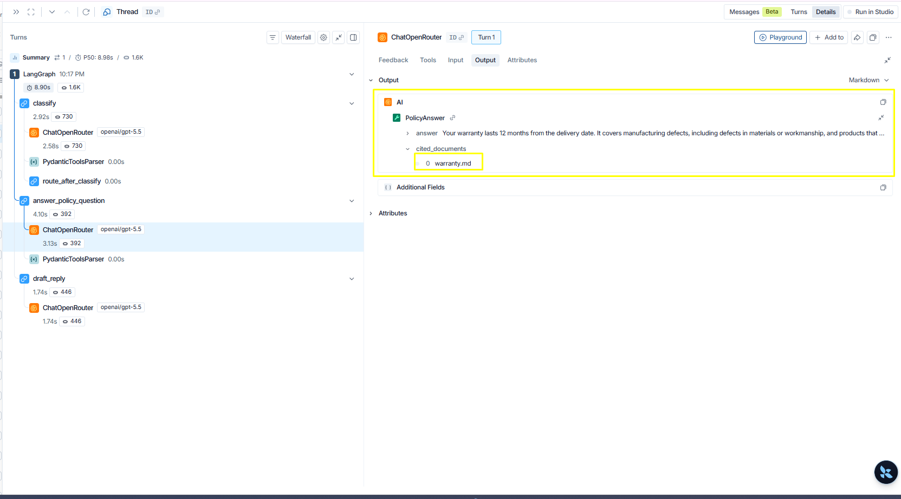

# Reading a storekeeper trace

storekeeper's core claim is that language tasks and business controls stay
separate. LangSmith traces make that visible: every run shows exactly where a
model was involved and where it was not.

The screenshots below are upstream examples from July 2026. This local
2026-10-28 fork adds `clarify_missing_order_reference` before plan validation;
the older screenshots do not show that node. No new live model, Shopify, or
LangSmith run was performed for the local extension.

## Enable tracing

Set these in `.env` (see `.env.example`):

```text
LANGSMITH_API_KEY=...
LANGSMITH_TRACING=true
LANGSMITH_PROJECT=storekeeper
```

Tracing sends run content (ticket text, order data, drafted replies) to
LangSmith. Leave it off if that data should stay on your machine.

Every `run_ticket.py` invocation then appears in the LangSmith project. The
**Threads** view groups runs by ticket id, because the graph uses the ticket
id as its checkpoint `thread_id`.

## Local clarification path

For a single cancellation without an order number, the graph first stops at
`clarify_missing_order_reference`. The `classify` call has completed, but
order lookup, the gate, approval, execution, and reply drafting have not run.

Supply the requested information with a separate invocation:

```powershell
uv run python scripts/run_ticket.py TICKET-CLARIFY-1 "Please cancel my order."
uv run python scripts/run_ticket.py TICKET-CLARIFY-1 --clarify CLARIFICATION_ID --order-reference '#1036'
```

The resume re-enters the clarification node, validates the reference, and
continues to `validate_task_plan` and the existing task pipeline. It does not
call the classifier again. If the gate passes, the run stops at a new approval
interrupt; only `--approve APPROVAL_ID` can then reach `execute_action`.
If the gate denies the request, the result is drafted without approval.

The clarification interrupt has `kind: "clarification"` and asks for
`order_reference`; an approval interrupt describes the store action. They
represent different decisions even though both use durable LangGraph
interrupts. Run these commands only while the API is stopped when they share
the same checkpoint database.

Offline regression tests cover these transitions with injected clients and
SQLite restarts. The deterministic `storekeeper.demo` mode demonstrates the
console flow without a live model or Shopify call; it does not establish
language-model quality or produce replacement evidence for these screenshots.

## A write request stops at the approval

Run a cancellation ticket and open its trace:

```powershell
uv run python scripts/run_ticket.py TICKET-DEMO-1 "Please cancel order #1001."
```



Three things to notice:

- `classify` holds the run's only model call. The customer's text goes in and
  a typed task comes out (`intent`, `order_reference`, `confidence`). The
  `requested_action` is derived in code from the intent, so the model cannot
  pick an action that does not match what it classified.
- In this upstream screenshot, `lookup_order` and `policy_gate` display 0.00s
  and have no model calls under them. That display is not a latency benchmark.
  The policy decision is plain Python; ticket text cannot argue with it.
- The tree ends at `await_approval`. There is no execute node anywhere in
  this trace — the write is structurally unreachable until a human decides.

## The write exists only after a human decision

Approve the pending action:

```powershell
uv run python scripts/run_ticket.py TICKET-DEMO-1 --approve INTERRUPT_ID
```



- The approval creates **Turn 2** on the same thread. The gap between the two
  turns is the human decision — it can be minutes, hours, or a process
  restart apart, because the pending state lives in SQLite checkpoints.
- `execute_action` appears for the first time. The Shopify write exists only
  in the post-approval trace.
- `draft_reply` makes the pipeline's second model call and outputs the
  customer reply. It is a draft; nothing is sent automatically.
- The run metadata shows `thread_id: TICKET-DEMO-1` — the thread is the ticket.

## A policy question never touches the gate

```powershell
uv run python scripts/run_ticket.py TICKET-DEMO-2 "How long is your warranty and what does it cover?"
```



- The current tree is `classify → clarify_missing_order_reference →
  validate_task_plan → process_task → draft_reply`; the clarification node
  passes through for a policy question.
  Inside `process_task`, a policy question uses the read-only answer path. There is no
  task pipeline at all: no order lookup, no gate, no approval — nothing to
  approve, because nothing writes.
- Open the policy-answer model call inside `process_task` and check its **Input**
  tab: the prompt contains the policy chunks retrieved from the local Chroma
  index, not whole policy files.
- The **Output** is a structured `PolicyAnswer` whose `cited_documents` name
  the sources used. Code verifies the citations afterwards and drops any
  document the model names but was never actually given.

## A multi-request ticket fans out

For v2 traces, open a ticket with independent requests. After
`validate_task_plan`, LangGraph creates one `process_task` branch per classified
task through `Send`. Several `await_approval` nodes may pause in the same turn.
Each resume addresses one interrupt id; `draft_reply` appears only after every
branch has completed, then composes the ordered results once.
# Local order discovery graph extension 2026-11-04

The opt-in fixture preview adds this nested shape:
`classify -> resolve_order_agent(agent -> tools -> agent ...) -> clarification -> validate -> process -> draft`.
Inside `request_order_reference`, customer information pauses with the existing
clarification kind; `await_approval` remains a separate later approval interrupt.
The local preview disables external LangSmith export. Inspect `order_resolution.events`
in API responses and the console's order lookup history instead. This is not a claim
that the new extension has been observed in a production LangSmith deployment.
